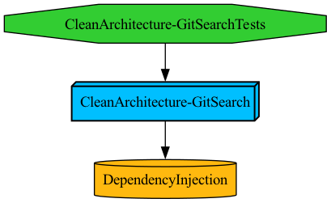

[한국어](README.md) | **English**

# CleanArchitecture-Example
> An iOS sample application following Clean Architecture with modular design powered by Tuist.

### Features
- Sign in with GitHub authentication
- GitHub user search with detailed results
- Profile view and logout

### Environment
- Modularized with Tuist 4.43.1
- Swift 5.x, iOS 16.0, Xcode 14.0
--- 
## Module Structure

### Core Modules
- **APP**
    - The core module that integrates every other module and provides the app's entry point.
    - Dependencies: Data, Presentation, Shared
    - Responsibilities
        1. Application lifecycle management
        2. Initial navigation setup
        3. Initial dependency registration
- **Shared**
    - Common utilities, extensions, and helpers shared across all modules.
    - Dependencies: none.
    - Responsibilities
        1. Extension functions
        2. Utility classes
- **DependencyInjection**
    - Infrastructure module for dependency injection across the application.
    - Dependencies: none.
    - Responsibilities:
        1. Dependency container implementation
        2. Service registration
### Clean Architecture Layers
- **Presentation**
    - The UI layer implementing presentation logic and user interface components.
    - Dependencies: DependencyInjection, Domain, Shared
    - Responsibilities
        1. ViewControllers
        2. ViewModels
        3. UI components
- **Domain**
    - The business logic layer containing use cases, entities, and repository interfaces.
    - Dependencies: DependencyInjection, Core, Shared
    - Responsibilities
        1. Business entities
        2. Use cases
        3. Repository interfaces
- **Data**
    - The layer implementing the repository interfaces defined in Domain.
    - Dependencies: DependencyInjection, Domain, Shared
    - Responsibilities
        1. Network communication
        2. Local storage
        3. DTOs and abstractions
- **Core**
    - Core business logic and infrastructure module.
    - Dependencies: DependencyInjection, Shared
    - Responsibilities
        1. Keychain storage
        2. Core business logic
--- 
## Architecture

### Layer Separation and Dependency Rules
- Follows the Clean Architecture dependency rule: dependencies point inward only.
1. **Outer layers**
    - UI and Data (App, Presentation, Data)
    - Reference the middle layer, but are never referenced by it
2. **Middle layer**
    - Application business rules (Domain)
    - Use cases and repository interfaces
3. **Inner layer**
    - Keychain storage, core shared business logic
    - No dependencies on any other layer
### Benefits
- Testability
    - Each layer is designed to be testable in isolation.
- Maintainability
    - Changes in one layer rarely ripple into the others.
- Flexibility
    - Outer-layer implementations are easy to swap.
- Extensibility
    - Protocol-based communication lets you add features without modifying existing code.
- Separation of concerns
    - Every module has its own well-defined responsibility.

### Drawbacks
- Module bloat
    - As the service grows, each layer module can grow excessively large, hurting code management and build times.
- Limited test granularity
    - As features expand, it becomes hard to run isolated tests per screen or per feature.

#### Future Improvements (Implemented)
- Adoption of TMA (The Modular Architecture)
    - Moved from the current layer-based modularization to feature-oriented modularization (Micro Feature Architecture), organizing the code into independent feature modules.
- Vertical slice modularization
    - Keeps Clean Architecture's layer separation inside each feature while slicing modules vertically per feature, clarifying inter-module dependencies and enabling isolated per-feature tests.
- Upgraded version
    - The improved architecture is available in the repo below. (Implemented)
    - https://github.com/Jeon0976/iOS-TheModularArchitecture-Sample
--- 
## Feature Details

### GitHub Auth & Token Management
- The GitHub OAuth authentication flow is implemented across the layers.
- The Core layer provides token store/read/delete through the TokenStorage protocol.
- GithubTokenUseCase in the Domain layer manages tokens via TokenStorage and requests API communication through the repository interface.
- In the Presentation layer, the ViewModel handles user events with Combine and calls the use case; the Coordinator handles navigation after authentication completes.

### User Search
- The Domain layer owns pagination for user search.
- In the Data layer, SearchUserRepository talks to the GitHub API for search results, and PosterImageRepository handles user avatar images.
- Images are cached through PosterLRUCacheStorage.
- In the Presentation layer, SearchUserViewModel loads paginated entities from SearchUserUseCase and renders the results with Combine.

### Profile
- Works the same way as the user search flow at its core.

### DI Container
- The DI Container registers and resolves dependencies keyed by the interface's metatype (ObjectIdentifier).
- Since call sites depend on interfaces rather than concrete implementations, every component must be registered into the container as its interface type.
- Repositories are registered as instances so a single instance is shared, singleton-style.
- Use cases are registered as closure-based factories, creating a new instance per resolution.
- The remaining limitation is that a missing registration is only discovered at runtime. In production you might use a library like Swinject, or switch to constructor injection (as the successor project does) to move this to compile time.

### Coordinator
- **AppCoordinator — implementation**
    - Manages the top-level navigation flow from the app's entry point.
    - Owns the lifecycles of RootCoordinator instances.
    - Handles screen transitions on login and logout.
- **RootCoordinator — interface**
    - The top-level Coordinator protocol, extending BaseCoordinator, that can start app-level flows.
    - Has the authority to initialize the app window and set the root screen.
    - Reports its completion to AppCoordinator through RootFinishDelegate.
- **BaseCoordinator — interface**
    - Each coordinator owns and manages its own navigation stack.
    - Manages child coordinators through the childCoordinators array.
    - Creates view controllers and injects dependencies through viewControllerFactory.
    - Notifies its parent on completion through finishDelegate.
    - attachChild / detachChild simplify registering and releasing child coordinators.

### Network
- A hand-rolled networking layer with no third-party dependencies.
- Protocol-oriented design for flexibility.
- Supports a stub mode, enabling tests without the network.
- Async networking built on Swift Concurrency instead of callbacks.
- Main components
    - NetworkEndpoint
        - Protocol encapsulating the basic information of a request
    - NetworkTask
        - Defines the request payload shape (plain, JSON, parameters, ...)
    - ParameterEncoding
        - Encodes parameters as URL or JSON
    - NetworkSession
        - Performs the actual request and handles the response
    - NetworkLogger
        - Logs request/response details for debugging
    - NetworkError
        - Enumerates the possible networking errors

### Storage
- Abstracted storage interfaces
    - Each storage layer is abstracted behind an interface, making implementations easy to swap.
    - Dependency injection enables mock implementations in tests.
- Token storage
    - The core protocol for token management; lives in the Core layer.
- Image cache storage
    - Implemented on an LRU (Least Recently Used) algorithm; concurrency handled with an actor.
    - A doubly linked list + dictionary combination guarantees O(1) access.
- User data storage
    - Volatile storage that lives only while the app is running.

### Data / Domain
- Protocol-based communication
    - Repository interfaces are defined in Domain and implemented in Data
- Swift Concurrency
    - async/await used throughout the Data and Domain layers
- Dependency injection
    - Both repositories and use cases are injected through interfaces
    - Components are registered and resolved by interface type through the DIContainer

### Presentation
- MVVM with Combine
    - Input/output separation improves testability
- MainActor guarantees main-thread safety for UI updates
- Coordinator pattern

## Tech Stack & Libraries
- Async: Swift Concurrency (Data & Domain)
- Data flow: Combine (Presentation)
- Patterns: MVVM, Coordinator, DIContainer
- Networking: URLSession
- Image caching: custom LRU cache
- Module management: Tuist
- Testing: XCTest
